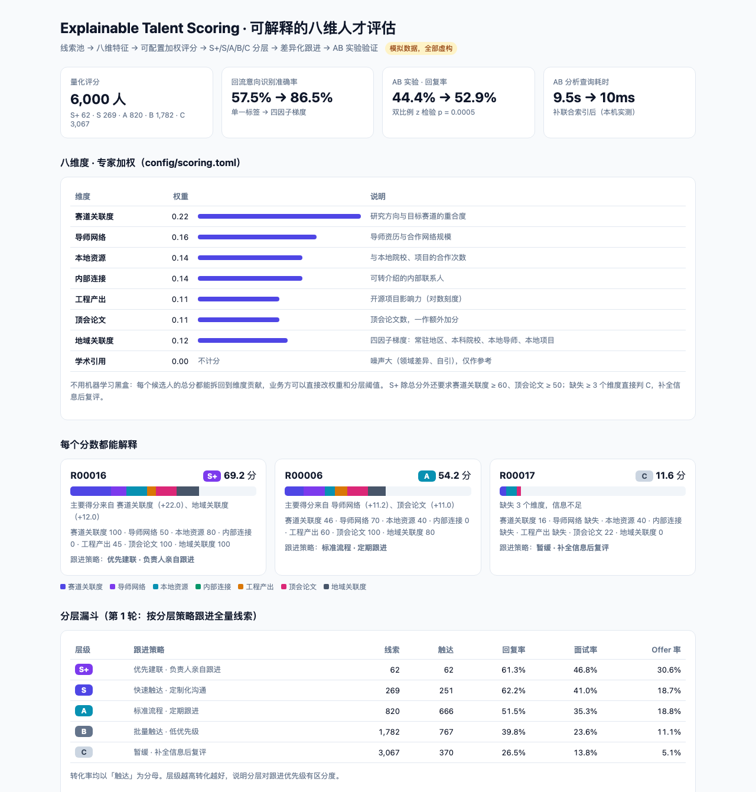
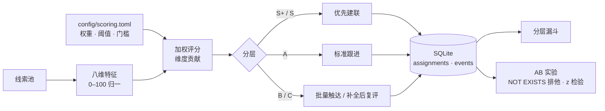
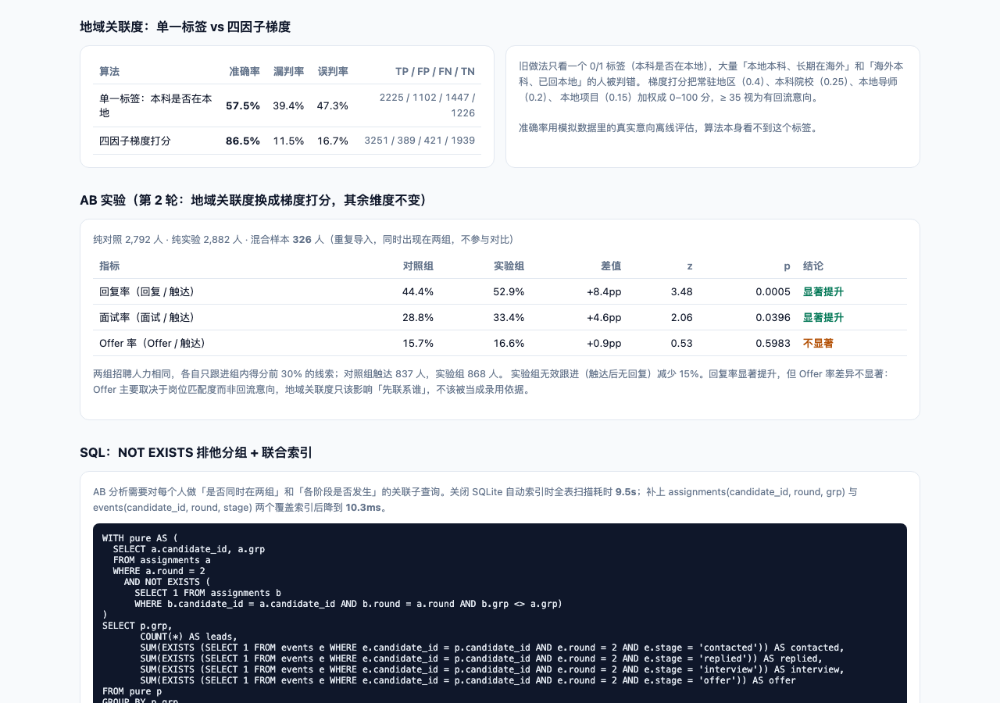

# Explainable Talent Scoring · 可解释的八维人才评估

**线索太多、人力太少时，先联系谁？用一套业务方看得懂、改得动的加权评分来回答，再用 AB 实验证明它真的有用。**

[在线报告](https://annawzhang.github.io/explainable-talent-scoring/) · Python 标准库 + SQLite，无第三方依赖

> 候选人、行为与转化全部为模拟数据。



## 解决什么问题

| 痛点 | 做法 |
|---|---|
| 线索池几千人，靠人工逐个判断，跟进顺序拍脑袋 | 八个维度加权成 0–100 分，分到 S+/S/A/B/C 五档，每档有对应跟进策略 |
| 模型打出的分数说不清，业务方不敢用 | 不用黑盒模型，每个总分都能拆回维度贡献，并生成「主要得分来自……」的说明 |
| 关键维度用单一 0/1 标签判断，大量误判 | 换成四因子梯度打分，识别准确率 57.5% → 86.5% |
| 改了策略不知道有没有用 | AB 实验：同样人力下比较回复率，双比例 z 检验 |
| 线索重复导入，同一个人落进两个实验组 | SQL 用 NOT EXISTS 做三层隔离，混合样本不参与对比 |
| 分析查询慢，看板刷新要等 | 补两个覆盖索引，AB 分析查询从约 10 秒降到约 10 毫秒 |

## 架构



## 评分规则

| 维度 | 权重 | 说明 |
|---|---|---|
| 赛道关联度 | 0.22 | 研究方向与目标赛道的重合度 |
| 导师网络 | 0.16 | 导师资历与合作网络规模 |
| 本地资源 | 0.14 | 与本地院校、项目的合作次数 |
| 内部连接 | 0.14 | 可转介绍的内部联系人 |
| 工程产出 | 0.11 | 开源项目影响力（对数刻度） |
| 顶会论文 | 0.11 | 顶会论文数，一作额外加分 |
| 地域关联度 | 0.12 | 四因子梯度：常驻地区 0.40、本科院校 0.25、本地导师 0.20、本地项目 0.15 |
| 学术引用 | 0 | 噪声大，只展示不计分 |

- S+ 除总分 ≥ 66 外，还要求赛道关联度 ≥ 60、顶会论文 ≥ 50，避免「样样还行、没有长板」的人进最高档。
- 缺失 ≥ 3 个维度直接判 C，标注「信息不足，补全后复评」；缺失维度按 0 计，不做插补。
- 权重合计必须为 1，配置写错时启动就报错。

## AB 实验



第 2 轮只换一个变量：对照组的地域关联度用「本科是否在本地」单一标签，实验组用四因子梯度。两组都只跟进组内得分前 30% 的线索。

| 指标 | 对照组 | 实验组 | p |
|---|---|---|---|
| 回复率 | 44.4% | 52.9% | 0.0005 |
| 面试率 | 28.8% | 33.4% | 0.040 |
| Offer 率 | 15.7% | 16.6% | 0.60（不显著） |

Offer 率不显著是有意保留的结论：Offer 取决于岗位匹配度，地域关联度只该决定「先联系谁」，不该被当成录用依据。

## 快速开始

```bash
python3 run.py                         # 生成 docs/index.html 与 docs/scores.csv（含索引耗时实测，约 10 秒）
python3 -m unittest discover -s tests  # 9 个测试
```

改 `config/scoring.toml` 里的权重或阈值后重新运行即可，无需改代码。

| 文件 | 作用 |
|---|---|
| `talentscore/synth.py` | 生成虚构线索池（含算法看不到的真实意向与匹配度，用于离线评估） |
| `talentscore/scoring.py` | 特征归一、加权评分、分层、识别准确率 |
| `talentscore/experiment.py` | 跟进模拟、SQLite 落库、漏斗、AB 查询、z 检验、索引对比 |
| `talentscore/report.py` | HTML 报告 |

## 设计取舍

- **专家加权而非机器学习**：样本里没有足够干净的转化标签，模型学到的多半是历史跟进偏好；加权规则能解释、能被业务方直接调整。
- **梯度代替标签**：单一标签把「本地本科、长期在海外」和「海外本科、已回本地」都判错，多因子加权后误判率从 47% 降到 17%。
- **固定人力做对比**：两组触达人数相同，比较的是「同样的力气花在谁身上」，而不是触达更多人。
- **混合样本直接排除**：不去猜它该算哪组，宁可少一点样本也不污染结论。

## 背景

本项目是作者在招聘数据产品实习中所做「八维评估模型 + 漏斗 AB」的公开复刻版：评分框架、分层策略、
NOT EXISTS 排他分组和索引调优思路一致，维度名称做了通用化处理，所有数据均为虚构。
